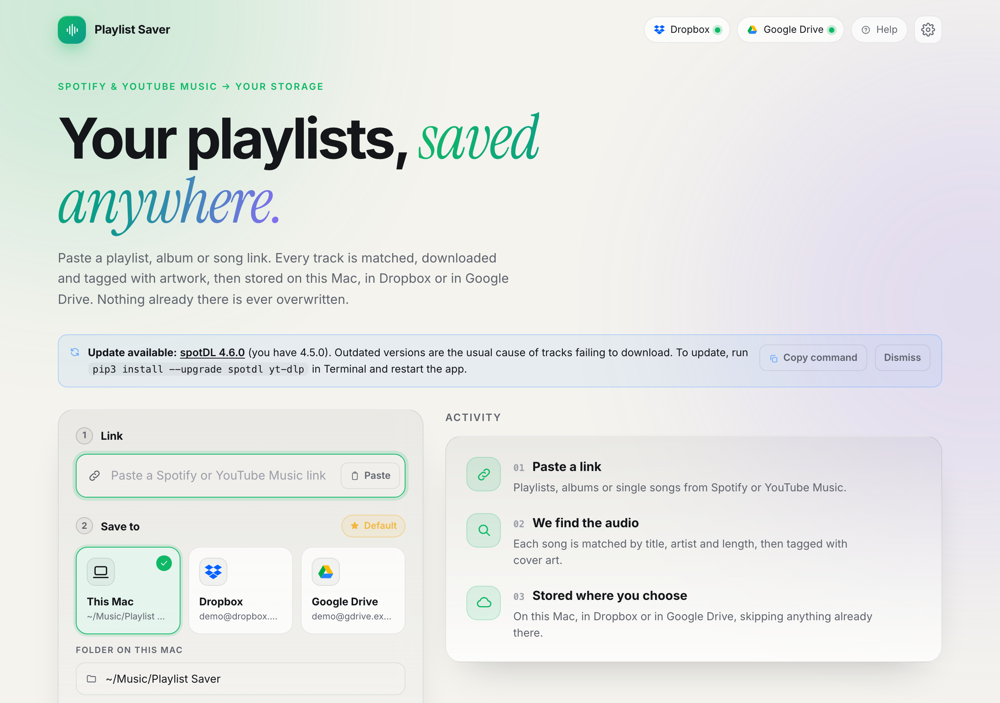

# Playlist Saver

A local web app for saving Spotify and YouTube Music playlists, albums and songs as audio files (MP3, M4A, FLAC, Opus) to this Mac, Dropbox or Google Drive.

> **Disclaimer.** Playlist Saver is only a graphical interface. It does not host, store or download any content itself: it runs the open-source tools [spotDL](https://github.com/spotDL/spotify-downloader), [yt-dlp](https://github.com/yt-dlp/yt-dlp) and [FFmpeg](https://ffmpeg.org), which you install and run on your own computer. Use it only for music you have the right to copy; you are responsible for following copyright law and the terms of the services involved. Not affiliated with or endorsed by Spotify, YouTube, Google, Amazon or Dropbox.

<p align="center">
  <a href="docs/USER_GUIDE.md"></a>
</p>

## 📖 User guide (start here if you are new)

**[Read the full user guide with screenshots →](docs/USER_GUIDE.md)**
It is written for people with no technical background and walks you through every step, including what to do when an error message appears. The same guide is built into the app: click **Help** at the top right.

| | |
| --- | --- |
| **Install** | [Before you start](docs/USER_GUIDE.md#before-you-start) · [Using Terminal](docs/USER_GUIDE.md#using-terminal-in-two-minutes) · [Step 1: Homebrew](docs/USER_GUIDE.md#step-1-install-homebrew) · [Step 2: Python, Node, FFmpeg](docs/USER_GUIDE.md#step-2-install-python-node-and-ffmpeg) · [Step 3: Download](docs/USER_GUIDE.md#step-3-download-playlist-saver) · [Step 4: spotDL](docs/USER_GUIDE.md#step-4-install-spotdl-and-the-apps-packages) · [Step 5: Start](docs/USER_GUIDE.md#step-5-start-the-app) · [Desktop shortcut](docs/USER_GUIDE.md#desktop-shortcut) · [Install problems](docs/USER_GUIDE.md#install-problems-and-how-to-fix-them) |
| **Use** | [Save your first playlist](docs/USER_GUIDE.md#save-your-first-playlist) · [Dropbox](docs/USER_GUIDE.md#connect-dropbox) · [Google Drive](docs/USER_GUIDE.md#connect-google-drive) · [Keep in sync](docs/USER_GUIDE.md#keep-a-playlist-in-sync) · [Duplicates](docs/USER_GUIDE.md#find-duplicate-songs) · [Troubleshooting](docs/USER_GUIDE.md#troubleshooting) |

**Features:** a searchable built-in user manual with screenshots, Spotify and YouTube Music links, Dropbox and Google Drive storage, never-overwrite uploads, saved playlists that re-check daily or weekly, a download queue, sync history, synced lyrics, `.m3u8` playlist files, an `Artist/Album` file layout, a duplicate finder, update notices for spotDL and yt-dlp, and a configurable server port.

It is a React + Vite front end on top of [spotDL](https://github.com/spotDL/spotify-downloader), driven by a small FastAPI server that runs the `spotdl` command, parses its progress, and streams it to the browser.

```
Browser (React + Vite, :5173)  ──/api──▶  FastAPI server (:8000)  ──▶  spotdl CLI  ──▶  YouTube Music audio + Spotify metadata
```

## Supported links

| Source | Works | Notes |
| --- | --- | --- |
| Spotify | Playlists, albums, tracks | Tracking parts such as `?si=` are removed automatically. Public playlists only unless you configure spotDL with your own Spotify API keys. |
| YouTube Music / YouTube | Playlists, albums (`playlist?list=`), single songs (`watch?v=`) | Endless "mix" playlists are treated as the single song. |
| Amazon Music | Not supported | Amazon does not publish playlist contents in a form these tools can read. Find the same playlist on Spotify or YouTube Music instead. |

## How it works

1. You paste a Spotify or YouTube Music link. Spotify audio is DRM-protected, so nothing can download it directly.
2. spotDL reads the playlist's track list and metadata from Spotify.
3. For each track it finds the best match on YouTube Music, downloads the audio with `yt-dlp`, converts it with `ffmpeg`, and tags it with title, artist, album, year and cover art.
4. The UI shows live progress per track. Tracks already in the output folder are skipped, so you can re-run a link safely to retry failures.

> **Quality note:** audio comes from YouTube Music, so real quality tops out around 128–256 kbps. Picking 320k or FLAC only re-encodes the same source into a bigger file.

> **Legal note:** downloading this way may violate Spotify's and YouTube's terms of service and copyright law in your country. Use it only for music you have the right to copy.

---

## Requirements

| Tool | Version | Used for |
| --- | --- | --- |
| Python | 3.10 or newer (tested on 3.14) | Runs spotDL and the API server |
| Node.js + npm | 18 or newer (tested on Node 26) | Runs the React dev server |
| spotDL | 4.x | Finds and downloads the tracks |
| ffmpeg | any recent | Converts audio and writes tags |
| Deno (optional, recommended) | any recent | Needed by yt-dlp for some YouTube downloads |

Playlist Saver does **not** bundle spotDL, yt-dlp or ffmpeg. You install them yourself (steps below) from their own projects: [spotDL](https://github.com/spotDL/spotify-downloader), [yt-dlp](https://github.com/yt-dlp/yt-dlp) and [FFmpeg](https://ffmpeg.org/download.html). The app only gives them a graphical interface.

Tested on macOS (Intel). It should work on Linux and Windows too, but the commands below assume macOS or Linux.

---

## Installation

> **New to the Terminal?** Follow the [step-by-step install guide](docs/USER_GUIDE.md#before-you-start) instead. It explains Homebrew, Terminal and every error you might meet. The short version for developers is below.

```bash
# 1. System tools (macOS with Homebrew; on Ubuntu/Debian: sudo apt install python3 python3-pip python3-venv nodejs npm ffmpeg)
brew install python node ffmpeg

# 2. Get the code
git clone https://github.com/langecornu/playlist-saver-app.git
cd playlist-saver-app

# 3. spotDL and the API server, in a private virtual environment (no activation needed: the app finds .venv by itself)
python3 -m venv .venv
.venv/bin/pip install -r server/requirements.txt      # Windows: .venv\Scripts\pip

# 4. Front-end packages
npm --prefix web install

# 5. Deno, which yt-dlp needs for some YouTube downloads (recommended)
.venv/bin/spotdl --download-deno
```

Why a virtual environment: Homebrew's Python refuses `pip install` outside one (`externally-managed-environment`), and the Desktop shortcut starts the app without any shell, so the app looks for `.venv` itself. To use another interpreter, set `PYTHON=/path/to/python`.

You can also run spotDL as `python3 -m spotdl`. Check it with `.venv/bin/spotdl --version`.

Playlist Saver does **not** bundle spotDL, yt-dlp or ffmpeg. You install them from their own projects: [spotDL](https://github.com/spotDL/spotify-downloader), [yt-dlp](https://github.com/yt-dlp/yt-dlp) and [FFmpeg](https://ffmpeg.org/download.html).

---

## Running the app

One command starts everything:

```bash
npm --prefix web run dev
```

This starts the web UI on port 5173 **and** launches the API server on port 8000 for you, using the `.venv` Python if it exists.

Open **http://localhost:5173**, paste a Spotify link, choose a format and quality, and press Download.

The page checks the API every few seconds. If the API stops, the UI shows an "API offline" banner, asks the dev server to restart it automatically, and recovers on its own. There is also a **Start server** button in the banner. Links copied from Spotify's Share menu (with `?si=...` tracking) are cleaned up automatically.

### Built-in user manual

Click **Help** at the top right of the app to open the full user manual: a step-by-step guide with screenshots, from installing to saving your first playlist, connecting Dropbox or Google Drive and keeping playlists in sync. It is searchable and organised by section. The text lives in `web/src/manual/content.ts` and the screenshots in `web/public/manual/`.

### Desktop shortcut (macOS and Linux)

To start the app without a terminal, create a Desktop icon once:

```bash
scripts/install-shortcut.sh
```

Double-clicking **Playlist Saver** on your Desktop then starts the app if it isn't running, waits until it is ready, and opens it in your browser. If it is already running it just opens the page. The first launch installs the front-end packages for you.

- On macOS the shortcut is a small app bundle created on your machine, so there is no "unidentified developer" warning. It carries the app logo as its icon; if Finder still shows a plain icon, move or relaunch Finder (`killall Finder`). It uses your login shell so it finds Node.js and Python the same way Terminal does.
- On Linux it is a `.desktop` file; your desktop may ask you to choose **Allow Launching** the first time.
- Stop the app with `scripts/launch.sh stop`. Logs are in `~/.config/playlist-saver/launcher.log`.
- Remove the shortcut with `scripts/install-shortcut.sh --remove`.
- Windows isn't automated: create a shortcut that runs `npm --prefix web run dev` and open `http://localhost:5173`.

The shortcut points at this folder, so run the installer again if you move the repository.

### Running the API by hand (optional)

If you'd rather run the API yourself, or you're not using the Vite dev server:

```bash
cd server
python3 -m uvicorn main:app --port 8000
```

The auto-start only works with `npm run dev`; `npm run preview` does not launch the API.

Files are saved to `~/Music/spotify-dl` by default, inside a subfolder named after the playlist or album (for example `~/Music/spotify-dl/Summer 2026/`). You can change the base folder in the UI, or turn the subfolder off with the "Save in a folder named after the playlist" switch. Single tracks are always saved directly in the base folder.

Because the "already downloaded" check looks inside the target folder, a playlist you downloaded before this option existed will download again into its new subfolder. Move the old files into that folder first to avoid that.

### Production build (optional)

```bash
cd web
npm run build      # outputs to web/dist
npm run preview    # serves the built app on :4173
```

The dev server proxies `/api` to `127.0.0.1:8000` (see `web/vite.config.ts`); keep the API server running either way.

---

## Keeping playlists up to date

Choose **Daily** or **Weekly** under *Keep in sync* when you download a playlist. The app then re-checks it on schedule and only adds tracks it does not already have. Existing files, local or in the cloud, are never replaced.

- Manage saved playlists in **Settings → Playlists**: change or pause the schedule, **Sync now**, or stop syncing. Stopping never touches your files.
- **History** (same tab) lists every download and check, how many tracks it added, and which ones.
- Checks run **only while the app is running**. If the computer was off, due playlists are checked at the next start.

## Download queue

Only a few downloads run at once (default 2, change it in **Settings → Defaults → Downloads at once**, 1 to 4). The rest wait in a queue and start automatically. This keeps Spotify and YouTube from rate-limiting you when several playlists are due together. A queued download can be cancelled before it starts.

## File options

| Option | Effect |
| --- | --- |
| **Organise files** | *Playlist folder* saves `Playlist/Artist - Title`. *Artist / Album* saves `Artist/Album/01 - Title`, building a library layout. |
| **Save synced lyrics** | Adds a `.lrc` file next to each song when lyrics are found. |
| **Write a playlist file** | Writes `<playlist>.m3u8` with the tracks in the original order and relative paths, so it keeps working if you move the folder. If the file already exists in a cloud folder it is left as it is (nothing is overwritten), so delete it there first if you want a fresh one. |
| **Duplicate finder** | **Settings → Library** lists songs stored more than once in your music folder. It only reports; it never deletes. |

Defaults for all of these live in **Settings → Defaults**.

## Updates for spotDL and yt-dlp

YouTube changes often, so an old spotDL or yt-dlp is the most common reason tracks fail. The app checks PyPI for newer versions (an anonymous request that sends none of your data) and shows a banner with the update command and a link to the release notes:

```bash
# the banner's Copy command button gives the exact line for your setup, for example:
.venv/bin/pip install --upgrade spotdl yt-dlp
```

Restart the app afterwards. You can dismiss the banner for a given version.

## Changing the server port

The local server uses port **8000** by default. If another program uses it, open **Settings → Advanced**, enter a port between 1024 and 65535 and save. The app checks the port is free. When the dev server started the API for you, **Restart now** brings it back on the new port (after downloads finish). If you start the API yourself, restart it with `--port <new port>`.

If you use Dropbox or Google Drive, the sign-in address contains the port, so add the new address (`http://localhost:<port>/api/oauth/callback`) as a Redirect URI in your Dropbox or Google app before reconnecting. Existing connections keep working.

---

## Saving to Dropbox or Google Drive

Pick a destination in the **Save to** step: **This Mac**, **Dropbox** or **Google Drive**.

| Mode | How | Result |
| --- | --- | --- |
| **Direct** | Choose a cloud service and leave *Also keep a copy on this Mac* off. | Files are downloaded to a temporary folder, uploaded, then deleted locally. Files that fail to upload are kept so you can retry. |
| **Copy** | Choose a cloud service and turn *Also keep a copy on this Mac* on. | Files are kept in your local folder and copied to the cloud. |
| **After the fact** | On a finished local job, click *Copy to Dropbox / Google Drive*. | Copies what was already downloaded. |

**Nothing is ever overwritten.** Before writing, the app lists what is already in the target folder and skips any track with the same name. Uploads are also sent in a "never replace" mode (Dropbox `add` mode with no auto-rename; Drive re-checks the name right before upload). Re-running a link only fetches the tracks that are missing.

**Defaults are remembered.** Click *Make default* next to the destination, or use Settings → Defaults (destination, folders, format, quality). They are restored the next time the app starts.

**Connections are remembered too.** Tokens are stored in `~/.config/playlist-saver/config.json` (file mode `0600`) and refreshed automatically. On startup the app checks each saved connection; if a token was revoked it shows *Reconnect* instead of failing silently. A network outage never signs you out. Use Settings → Connections → *Disconnect* to remove a connection and its stored tokens (the app asks you to confirm).

### Connect Dropbox

1. Open https://www.dropbox.com/developers/apps and click **Create app**.
2. Choose **Scoped access**, then **App folder** (safest) or **Full Dropbox**, and name it.
3. On the **Permissions** tab enable `files.metadata.read`, `files.metadata.write`, `files.content.read`, `files.content.write` and `account_info.read`, then click **Submit**.
4. On the **Settings** tab add this **Redirect URI**: `http://localhost:8000/api/oauth/callback`
5. Copy the **App key**, open Settings → Connections → Dropbox in the app, paste it and click **Connect**. No secret is needed (the app uses OAuth with PKCE).

### Connect Google Drive

1. Open https://console.cloud.google.com/, create a project and enable the **Google Drive API**.
2. Configure the **OAuth consent screen** (External, add yourself as a test user).
3. Under **Credentials** create an **OAuth client ID** of type **Desktop app**. If your client type asks for it, add the redirect URI `http://localhost:8000/api/oauth/callback`.
4. In the app, open Settings → Connections → Google Drive, paste the **Client ID** and **Client secret**, choose the access level and click **Connect**.

Access levels: **App files only** (`drive.file`) lets the app see only files and folders it created, which is the safest. **Full Drive** (`drive`) lets you pick any existing folder and detect duplicates already there.

Credentials stay on your machine and are never sent back to the browser.

### Try it without an account (demo mode)

```bash
export PLAYLIST_SAVER_MOCK_CLOUD=/tmp/playlist-saver-demo   # both providers become local folders
export PLAYLIST_SAVER_HOME=/tmp/playlist-saver-home         # separate config, optional
# optional: PLAYLIST_SAVER_MOCK_DELAY=0.5  PLAYLIST_SAVER_MOCK_CONNECTED=0
cd server && python3 -m uvicorn main:app --port 8000
```

Dropbox and Google Drive then appear as connected demo accounts backed by folders under that path.

### Tests

```bash
cd server && python3 -m unittest discover tests   # API
cd web && npm test                                # manual search, content and docs/USER_GUIDE.md checks
cd web && npm run guide                           # regenerate docs/USER_GUIDE.md after editing the manual
```

---

## Using the command line only

You don't need the UI to use spotDL:

```bash
mkdir -p ~/Music/spotify-dl && cd ~/Music/spotify-dl
spotdl download "https://open.spotify.com/playlist/<playlist-id>"
```

Useful options: `--format mp3|m4a|flac|opus|ogg|wav`, `--bitrate 192k`, `--threads 4`, `--overwrite skip|force|metadata`.

---

## Troubleshooting

| Problem | Fix |
| --- | --- |
| `spotdl: command not found` | Run it as `.venv/bin/spotdl`, or `python3 -m spotdl`. |
| UI banner says "spotDL missing" | The API server couldn't find `spotdl`. It checks your `PATH`, the usual Python install folders, and `python -m spotdl`. Run `.venv/bin/pip install -r server/requirements.txt` from the project folder. |
| "API offline" banner won't clear | Run `python3 -m uvicorn main:app --port 8000` from `server/` and read the error. Usually a missing dependency (repeat the pip step above) or another process on port 8000. |
| `address already in use` on port 8000 | Something is already using the port. Stop the other process, or change the port in `web/vite.config.ts`. |
| Some tracks fail with `AudioProviderError` | Run `.venv/bin/spotdl --download-deno`, then download the same link again. Saved tracks are skipped. |
| `ffmpeg was not found` | Install it with `brew install ffmpeg`. |
| Playlist lookup is slow or stalls | Spotify rate-limits requests. Wait a minute, or avoid running several spotDL jobs at once. |
| Private playlist won't load | spotDL can only read public playlists without your own Spotify API credentials. Make it public, or create an app at https://developer.spotify.com and pass `--client-id` and `--client-secret`. |
| Wrong song downloaded | Matches come from YouTube search, so live or cover versions can slip through. Delete the file and download the single track by its Spotify link. |

---

## Project layout

```
.
├── server/
│   ├── main.py              FastAPI app: jobs and queue, spotdl runner, scheduler, settings, OAuth, local-only guard
│   ├── links.py             Spotify / YouTube Music link parsing and cleaning
│   ├── versions.py          Installed vs latest spotDL and yt-dlp
│   ├── library.py           Duplicate-song finder
│   ├── cloud.py             Provider base class, Dropbox and Google Drive clients, OAuth (PKCE) helpers
│   ├── sync.py              Uploads finished files, never overwrites, placeholder seeding
│   ├── config.py            Persistent settings, tokens, saved playlists and history (~/.config/playlist-saver)
│   ├── mock_cloud.py        Folder-backed demo provider
│   ├── tests/               Unit tests
│   └── requirements.txt     Python dependencies
├── docs/
│   └── USER_GUIDE.md        Illustrated user guide (generated from the in-app manual)
├── scripts/
│   ├── assets/              App icon: icon-1024.png (source), icon-512.png, AppIcon.icns
│   ├── launch.sh            Start the app if needed and open it in the browser
│   └── install-shortcut.sh  Create or remove the Desktop shortcut
└── web/
    ├── index.html
    ├── vite.config.ts       Dev server, /api proxy, API auto-start
    └── src/
        ├── App.tsx          Shell: topbar, composer, activity feed
        ├── api.ts           Typed API client
        ├── ui.tsx           Modal, toasts, switch, segmented control
        ├── icons.tsx        Icons and provider marks
        ├── components/      Composer, JobCard, SettingsDialog (+ Playlists, Library, Advanced panels), UpdateBanner, FolderPicker, HelpDialog
        ├── manual/          User manual text, search and its tests
        └── styles.css       Design tokens, light and dark themes
```

### API

| Method | Path | Purpose |
| --- | --- | --- |
| `POST` | `/api/jobs` | Queue a download (`url`, `format`, `bitrate`, `output_dir`, `subfolder`, `destination`, `keep_local`, `cloud_dest`, `naming`, `lrc`, `m3u`, `auto_sync`) |
| `GET` | `/api/jobs` | List jobs |
| `GET` | `/api/jobs/{id}/events` | Server-sent events stream of job state |
| `POST` | `/api/jobs/{id}/cancel` | Stop a running job |
| `POST` | `/api/jobs/{id}/copy` | Copy a finished job's files to a cloud service |
| `GET` / `PUT` | `/api/settings` | Read or update saved defaults (also returns provider status) |
| `PUT` | `/api/providers/{key}/credentials` | Save app credentials for a provider |
| `POST` | `/api/providers/{key}/connect` | Start the OAuth flow |
| `POST` | `/api/providers/{key}/disconnect` | Remove stored tokens |
| `GET` / `POST` | `/api/providers/{key}/folders` | Browse or create cloud folders |
| `GET` | `/api/oauth/callback` | OAuth redirect target |
| `GET` | `/api/playlists` | Saved playlists with schedule and last result |
| `PATCH` / `DELETE` | `/api/playlists/{id}` | Change the schedule, or stop syncing |
| `POST` | `/api/playlists/{id}/sync` | Check a saved playlist now |
| `GET` | `/api/history` | What each download or check added |
| `GET` | `/api/library/duplicates` | Report songs stored more than once |
| `GET` | `/api/versions` | Installed and latest spotDL / yt-dlp |
| `POST` | `/api/restart` | Restart the API (only when started by the dev server) |
| `GET` | `/api/defaults` | Default output folder and whether spotDL was found |

The API only accepts requests whose `Host` and `Origin` are local, so other websites cannot drive it from your browser. The job list lives in server memory, so restarting the API clears the Activity list. Saved playlists, history and settings are stored on disk. Files are never affected.

## Credits

Built on [spotDL](https://github.com/spotDL/spotify-downloader), [yt-dlp](https://github.com/yt-dlp/yt-dlp), [FastAPI](https://fastapi.tiangolo.com/), [React](https://react.dev/) and [Vite](https://vite.dev/).

## License and contributing

Released under the [MIT License](LICENSE). This license covers only the code in this repository; it does not grant any rights to music or other content, and it does not cover spotDL, yt-dlp or FFmpeg, which have their own licenses.

Pull requests are welcome. The `main` branch is protected: every change goes through a pull request that the repository owner must approve.
