# Playlist Saver user guide

<!-- Generated from web/src/manual/content.ts by `npm run guide` in web/. Edit that file, not this one. -->

The same guide is available inside the app: click **Help** at the top right.

## Contents

**Getting started**

- [Welcome](#welcome)
- [How it works](#how-it-works)
- [Which links work](#which-links-work)

**Install**

- [Before you start](#before-you-start)
- [Using Terminal in two minutes](#using-terminal-in-two-minutes)
- [Step 1: Install Homebrew](#step-1-install-homebrew)
- [Step 2: Install Python, Node and FFmpeg](#step-2-install-python-node-and-ffmpeg)
- [Step 3: Download Playlist Saver](#step-3-download-playlist-saver)
- [Step 4: Install spotDL and the app’s packages](#step-4-install-spotdl-and-the-apps-packages)
- [Step 5: Start the app](#step-5-start-the-app)
- [Desktop shortcut](#desktop-shortcut)
- [Install problems and how to fix them](#install-problems-and-how-to-fix-them)

**Saving music**

- [Save your first playlist](#save-your-first-playlist)
- [Watching progress](#watching-progress)
- [Choose where to save](#choose-where-to-save)
- [Format and quality](#format-and-quality)
- [Lyrics, playlist files and layout](#lyrics-playlist-files-and-layout)

**Cloud storage**

- [Saving to Dropbox or Google Drive](#saving-to-dropbox-or-google-drive)
- [Connect Dropbox](#connect-dropbox)
- [Connect Google Drive](#connect-google-drive)
- [Reconnect or disconnect](#reconnect-or-disconnect)

**Automatic updates**

- [Keep a playlist in sync](#keep-a-playlist-in-sync)
- [History and the download queue](#history-and-the-download-queue)

**Keeping things tidy**

- [Find duplicate songs](#find-duplicate-songs)
- [Update spotDL and yt-dlp](#update-spotdl-and-yt-dlp)
- [Change the server port](#change-the-server-port)

**Help**

- [Troubleshooting](#troubleshooting)
- [Questions and privacy](#questions-and-privacy)

---

## Getting started

### Welcome

**Playlist Saver** turns a Spotify or YouTube Music link into a folder of music files (MP3, M4A, FLAC or Opus) on your computer, in Dropbox or in Google Drive. Every song is tagged with its title, artist, album and cover art.

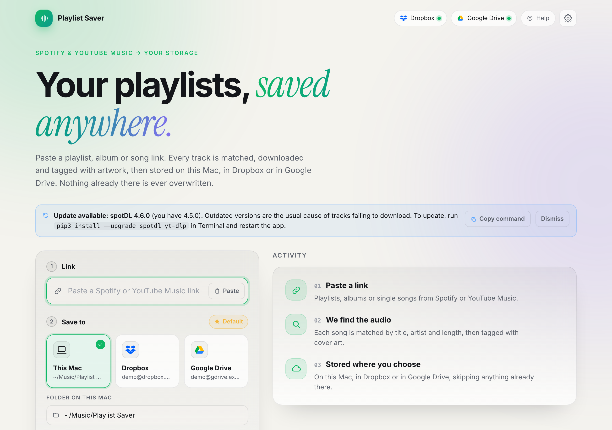

<sub>The home screen. Paste a link on the left; progress shows on the right.</sub>

You use it in your web browser, but it runs **only on your own computer**. Nothing is uploaded to a Playlist Saver website, because there isn't one.

- **Install** covers the one-time setup. It takes about 15 minutes.
- **Saving music** shows how to save your first playlist.
- **Cloud storage** explains how to save to Dropbox or Google Drive.
- **Automatic updates** keeps playlists fresh without you doing anything.
- **Help** has fixes for the most common problems.

> [!TIP]
> Use the search box at the top of this window to jump straight to an answer, for example “port”, “Dropbox” or “duplicates”.

### How it works

Playlist Saver is a friendly screen on top of three free, open-source tools that you install once: **spotDL**, **yt-dlp** and **FFmpeg**. The app does not contain or download any music by itself.

1. You paste a link. The app reads the list of songs from Spotify or YouTube Music.
2. For each song, spotDL finds the best matching audio on YouTube Music.
3. yt-dlp fetches the audio and FFmpeg converts it to your chosen format and adds the title, artist, album and cover art.
4. The file is saved where you chose. Songs you already have are skipped.

> [!IMPORTANT]
> The audio comes from YouTube Music, so real quality tops out around 128–256 kbps. Choosing 320 kbps or FLAC only stores the same sound in a bigger file.

> [!IMPORTANT]
> Use Playlist Saver only for music you have the right to copy. You are responsible for following copyright law and the terms of the services involved. Playlist Saver is not affiliated with Spotify, YouTube, Google, Amazon or Dropbox.

### Which links work

- **Spotify**: playlists, albums and single tracks. The playlist must be **public** unless you have set up your own Spotify developer keys.
- **YouTube Music and YouTube**: playlists, albums and single songs. Endless “mix” playlists are treated as just the one song.
- **Amazon Music** is not supported, because Amazon does not publish playlist contents in a form these tools can read. Find the same playlist on Spotify or YouTube Music instead.

> [!TIP]
> Links copied with Spotify’s Share button end in extra tracking such as `?si=…`. The app removes that for you, so paste the link exactly as copied.

---

## Install

### Before you start

You do **not** need to be technical. You will copy a few lines of text, paste them into a window called Terminal and press Return. This guide explains every step and what to do if something goes wrong. Allow about **30 minutes**, mostly waiting. You only do it once.

You need:

- A Mac (this guide). Linux is similar; Windows is covered briefly at the end of “Step 2”.
- An **administrator** account on the Mac. That is the account you normally use to install apps, and its password is the one you type to allow changes.
- An internet connection.

In plain words, these are the pieces you will install, and why:

- **Homebrew**: think of it as an “App Store for tools”. It installs the other pieces for you with one line each.
- **Python**, **Node.js** and **FFmpeg**: engines the app runs on. You never open them yourself.
- **spotDL**: the open-source tool that finds and fetches the songs.
- **Playlist Saver**: the friendly screen you will actually use.

> [!TIP]
> Not sure which Mac you have? Click the Apple menu → About This Mac. If it says “Chip: Apple M1/M2/M3/M4”, you have an Apple silicon Mac. If it says “Processor: Intel”, you have an Intel Mac. It matters in one place in Step 1.

### Using Terminal in two minutes

**Terminal** is a built-in Mac app where you give the computer written instructions. Everything in this guide is copy and paste. You never have to understand the commands.

1. Press **Command + Space**, type **Terminal** and press **Return**.
2. A window opens with a line ending in `%`. That line is the **prompt**. It means “ready for your instruction”.
3. Copy a command from this guide with its **Copy** button, click inside the Terminal window, press **Command + V** to paste and press **Return** to run it.
4. **Wait** until the `%` prompt appears again. Only then is the command finished. Some take several minutes and print lots of text. That is normal.

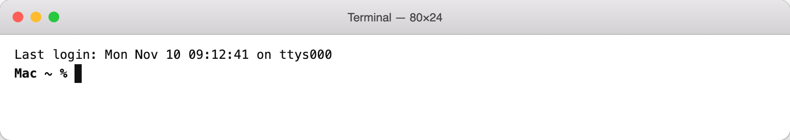

<sub>Illustration: a new Terminal window. The prompt on your Mac shows your own name.</sub>

- **Password:** when Terminal asks for your password, you will see **nothing** appear as you type, not even dots. That is a security feature. Type it anyway and press Return.
- **Stuck or typed something wrong?** Press **Control + C** to cancel and get the prompt back.
- **Red text** is not always a problem. Judge by the last few lines: do they say “success” or “error”?
- **Lost?** Close the Terminal window and open a new one. Nothing is damaged by doing that.

> [!IMPORTANT]
> Copy commands exactly, one block at a time. If a block has several lines, paste all of them together; Terminal runs them in order.

### Step 1: Install Homebrew

Homebrew is a free, widely used installer for Mac tools (brew.sh). If you already have it, check with `brew --version` and skip to Step 2.

1. Open Terminal (see the previous section).
2. Copy the command below, paste it into Terminal and press **Return**.
3. If it says **Press RETURN/ENTER to continue**, press **Return**.
4. When asked for **Password:**, type the password you use to log in to your Mac and press Return. Nothing shows while you type.
5. If a window pops up asking to install the **command line developer tools**, click **Install** and wait. It can take 10 minutes or more. The Terminal then carries on by itself.
6. Wait for “Installation successful!” and the `%` prompt.

**Install Homebrew**

```bash
/bin/bash -c "$(curl -fsSL https://raw.githubusercontent.com/Homebrew/install/HEAD/install.sh)"
```

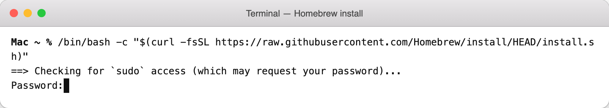

<sub>Illustration: the password prompt. Nothing appears as you type; that is normal.</sub>

> [!IMPORTANT]
> **Apple silicon Macs (M1 and newer):** at the end Homebrew prints a section called **Next steps** with three lines to run. Copy **those three lines from your own Terminal window** (they contain your user name) and run them, otherwise Terminal will not find Homebrew. Intel Macs normally have no Next steps.

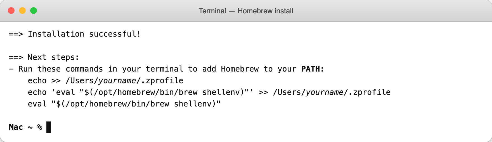

<sub>Illustration: the Next steps. Your lines contain your own user name.</sub>

Check that it worked:

```bash
brew --version
```

You should see a line such as `Homebrew 4.x.x`. If you see `command not found: brew` instead, see “Install problems and how to fix them”.

### Step 2: Install Python, Node and FFmpeg

With Homebrew ready, this single line installs all three. It takes about 5–15 minutes and prints a lot of text. Wait for the `%` prompt.

**Mac**

```bash
brew install python node ffmpeg
```

Messages saying something is “already installed” or “up-to-date” are harmless. Now check each one. You should see a version number for every command:

```bash
python3 --version
node --version
ffmpeg -version
```

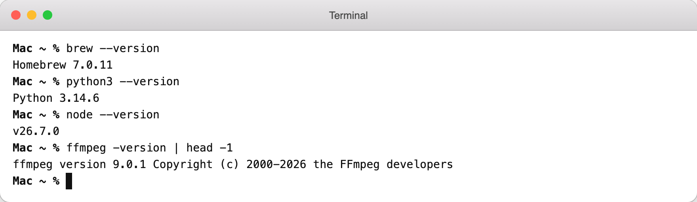

<sub>Real output from a working setup. Your version numbers will differ; that is fine.</sub>

> [!TIP]
> If a command says `command not found`, close Terminal, open a new window and try again.

**Ubuntu / Debian Linux** uses its own installer instead of Homebrew:

**Linux**

```bash
sudo apt update
sudo apt install python3 python3-pip python3-venv nodejs npm ffmpeg
```

**Windows:** install Python and Node.js from their websites (tick “Add to PATH” in the Python installer) and FFmpeg with `winget install ffmpeg`. The Windows equivalent of the commands in the next steps replaces `.venv/bin/` with `.venv\Scripts\`.

### Step 3: Download Playlist Saver

1. On the project’s GitHub page, click the green **Code** button, then **Download ZIP**.
2. Open your **Downloads** folder and double-click the ZIP file to unzip it. A folder named like `playlist-saver-app-…` appears.
3. Drag that folder into your **Documents** folder, where it can stay. The Desktop icon you make later points to this folder, so don’t move it afterwards.
4. In Terminal, type `cd` followed by **one space**. Don’t press Return yet.
5. Drag the folder from Finder **into the Terminal window**. Its location is typed for you.
6. Press **Return**. Terminal is now “inside” the folder.

Check that you are in the right place. This lists the folder’s contents; you should see `server`, `web` and `README.md`:

```bash
ls
```

> [!TIP]
> If you use Git, you can run `git clone https://github.com/langecornu2027/playlist-saver-app.git` and `cd playlist-saver-app` instead. The Mac may then offer to install the command line developer tools; click Install.

> [!IMPORTANT]
> Every command in the next steps must be run **from this folder**. If you open a new Terminal window later, repeat steps 4 to 6 above first.

### Step 4: Install spotDL and the app’s packages

Run these one block at a time from the app’s folder, waiting for the `%` prompt after each. The first one creates a private workspace called `.venv` so nothing else on your Mac is changed. You never need to “activate” it.

**1. Create the workspace and install spotDL (a few minutes)**

```bash
python3 -m venv .venv
.venv/bin/pip install -r server/requirements.txt
```

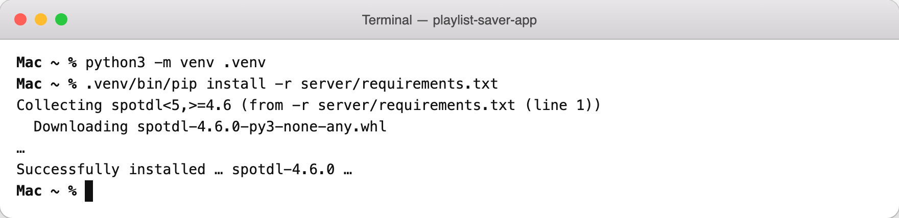

<sub>Illustration: lots of text scrolls by. The line that matters is “Successfully installed … spotdl …” at the end.</sub>

**2. Install the screen’s packages**

```bash
npm --prefix web install
```

**3. Let spotDL fetch Deno (avoids failures later)**

```bash
.venv/bin/spotdl --download-deno
```

Finally, check spotDL is installed. It should print a version such as `4.6.0`:

```bash
.venv/bin/spotdl --version
```

> [!IMPORTANT]
> If you see `error: externally-managed-environment`, you used `pip3` instead of `.venv/bin/pip`. Copy the commands above exactly as written.

### Step 5: Start the app

```bash
npm --prefix web run dev
```

After a few seconds Terminal shows a line with **Local: http://localhost:5173/**. Open that address in your web browser (Safari, Chrome, Firefox…).

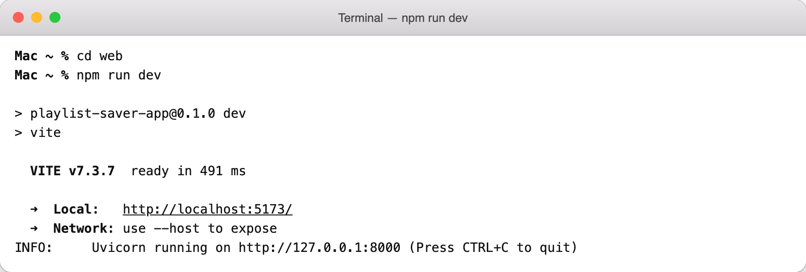

<sub>Real output: when you see Local: and the address, the app is running.</sub>


<sub>Success: this is the app. Press the **Help** button to open this manual any time.</sub>

> [!IMPORTANT]
> Keep the Terminal window open while you use the app. Press **Control + C** in it to stop the app.

> [!TIP]
> Next, create a Desktop icon so you never have to open Terminal again.

### Desktop shortcut

A shortcut means you can start Playlist Saver with a double-click, like any other app. Stop the app first (Control + C in Terminal), then run this once from the app’s folder:

```bash
scripts/install-shortcut.sh
```

A **Playlist Saver** icon appears on your Desktop. Double-click it: if the app isn’t running it starts it, waits until it is ready, then opens it in your browser. If it is already running, it just opens the page. From now on you can close Terminal.

- The first start installs the screen’s packages for you, so it takes a little longer.
- On a Mac the icon is created on your computer, so there is no “unidentified developer” warning.
- On Linux your desktop may ask you to choose **Allow Launching** the first time.
- Windows isn’t automated: make a shortcut that runs `npm --prefix web run dev` and open http://localhost:5173.

To stop the app, or remove the icon:

```bash
scripts/launch.sh stop
scripts/install-shortcut.sh --remove
```

> [!IMPORTANT]
> The shortcut points at the app’s folder. If you move the folder, run the installer again. If the app won’t start, the reason is written to `~/.config/playlist-saver/launcher.log`.

### Install problems and how to fix them

Find your message below. Almost everything is fixed by closing Terminal, opening a new window and trying again.

**`zsh: command not found: brew`**

- Close Terminal and open a new window, then try `brew --version` again.
- On an Apple silicon Mac this usually means the **Next steps** from Step 1 were skipped. Run them now: `echo 'eval "$(/opt/homebrew/bin/brew shellenv)"' >> ~/.zprofile` and then `eval "$(/opt/homebrew/bin/brew shellenv)"`.
- If it still fails, Homebrew did not finish installing. Run the Step 1 command again.

**`Need sudo access on macOS (e.g. the user … needs to be an Administrator)!`**

- Your account is not an administrator. Log in with an administrator account, or open System Settings → Users & Groups and ask the administrator to make your account one.

**Terminal asks for a password and nothing appears when I type**

- This is normal. Type your Mac password and press Return.

**A window asks to install the command line developer tools**

- Click **Install** and wait. It can take 10 minutes or more. If it says the software cannot be downloaded, check your internet connection and try again, or run `xcode-select --install`.

**`curl: (6) Could not resolve host` or `Failed to connect`**

- The Mac can’t reach the internet. Check your Wi-Fi, switch off any VPN or work proxy, and run the command again.

**`Error: … is not writable` or `Permission denied` while installing with brew**

```bash
sudo chown -R $(whoami) $(brew --prefix)/*
```

- Run the line above (it asks for your password), then repeat the `brew install` command.

**`zsh: command not found: python3`, `node` or `ffmpeg` after installing**

- Close Terminal, open a new window and check again.
- Run `brew install python node ffmpeg` once more, then `brew doctor` and follow what it says.

**`error: externally-managed-environment`**

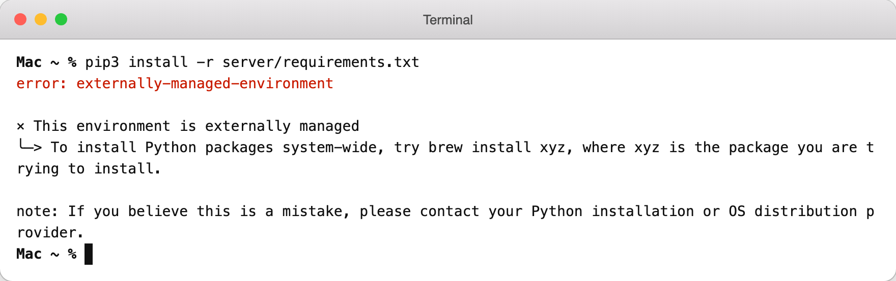

<sub>Illustration of this error.</sub>

- You ran `pip3 install …` directly. Homebrew’s Python does not allow that. Use the exact `.venv/bin/pip …` commands from Step 4 instead.

**`No such file or directory`** (for example `.venv/bin/pip` or `cd`)

- Terminal is not inside the app’s folder. Repeat the `cd` + drag-the-folder trick from Step 3, run `ls` and make sure you see `server` and `web`.

**`Port 5173 is in use`**

- Another copy is already running. Open http://localhost:5173 (it may already be working), or stop the other copy with `scripts/launch.sh stop`. Otherwise open the address Terminal prints, which uses the next number.

**The page loads but shows “API offline” or “spotDL missing”**

- Wait 10 seconds, then press **Start server** in the banner.
- If it persists, Step 4 did not finish. Stop the app (Control + C), repeat Step 4 from the app’s folder and watch for an error at the end.

> [!TIP]
> Still stuck? Open the **Log** tab of a download, or `~/.config/playlist-saver/launcher.log`, and report the last lines in an issue on the project’s GitHub page.

---

## Saving music

### Save your first playlist

1. In Spotify or YouTube Music, open the playlist and choose **Share → Copy link**.
2. In Playlist Saver, click the **Link** box and paste, or press the **Paste** button.
3. Leave **This Mac** selected under **Save to** for now.
4. Press the big green **Download** button.

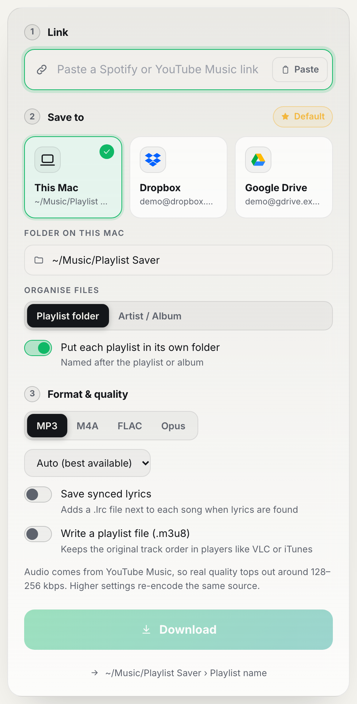

<sub>Step 1 is the Link box. Nothing else is needed to get started.</sub>

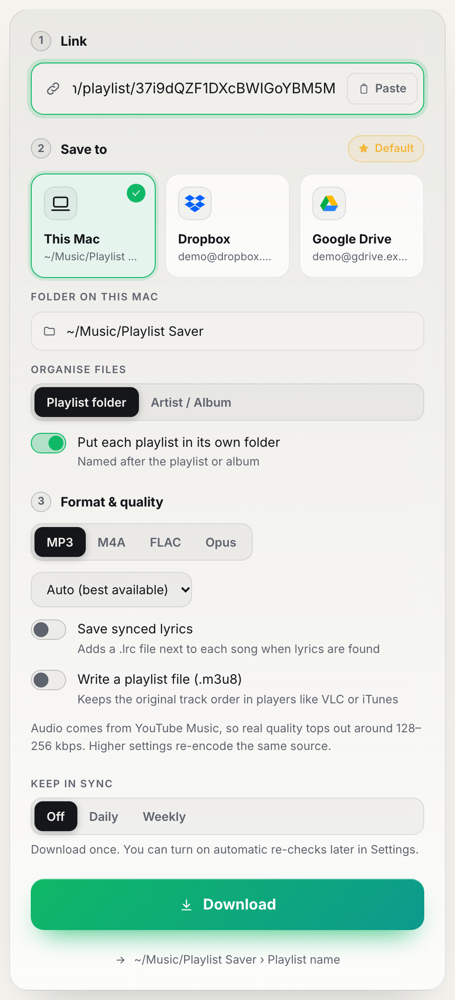

<sub>Once a link is pasted, the choices appear: where to save, format and how often to re-check.</sub>

Your songs appear in a **folder named after the playlist**, inside your music folder. Playlist Saver never overwrites anything: running the same link again only adds missing songs.

> [!TIP]
> Under the Download button the app shows exactly where files will go, for example `~/Music/Playlist Saver › Playlist name`.

### Watching progress

Each download gets a card in the **Activity** list on the right, with a live progress bar.

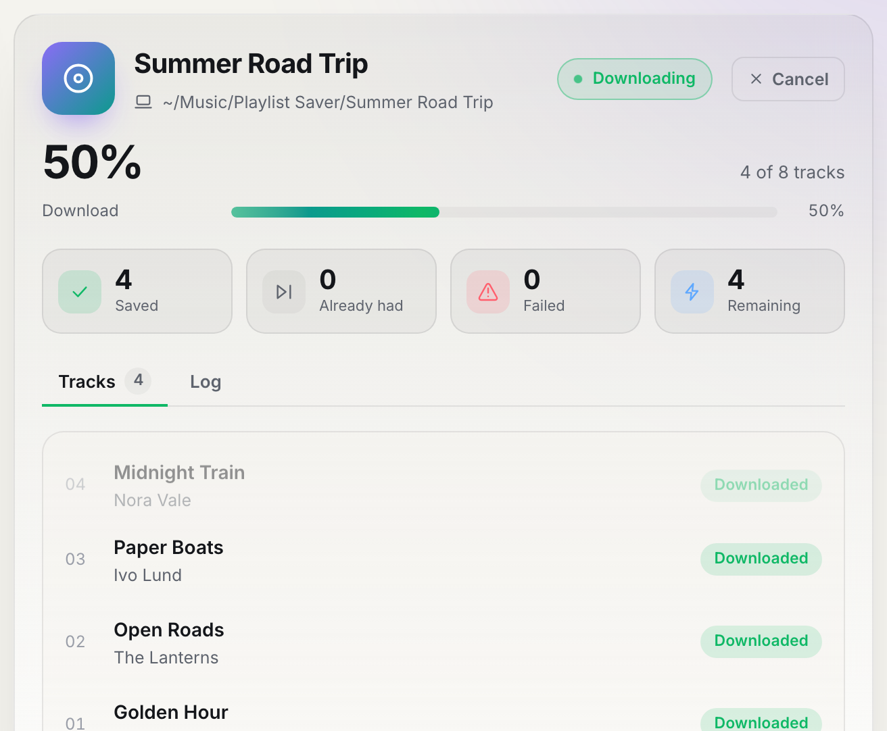

<sub>While running, you see the progress bar and each song as it finishes.</sub>

- **Saved**: new songs added now.
- **Already had**: songs that were already in the folder, so they were skipped.
- **Failed**: songs that couldn’t be fetched. Each one is listed by name with the reason, and a **Retry** button appears next to it once the download has finished. Retry fetches just that song into the same folder.
- **Remaining**: songs still to come.

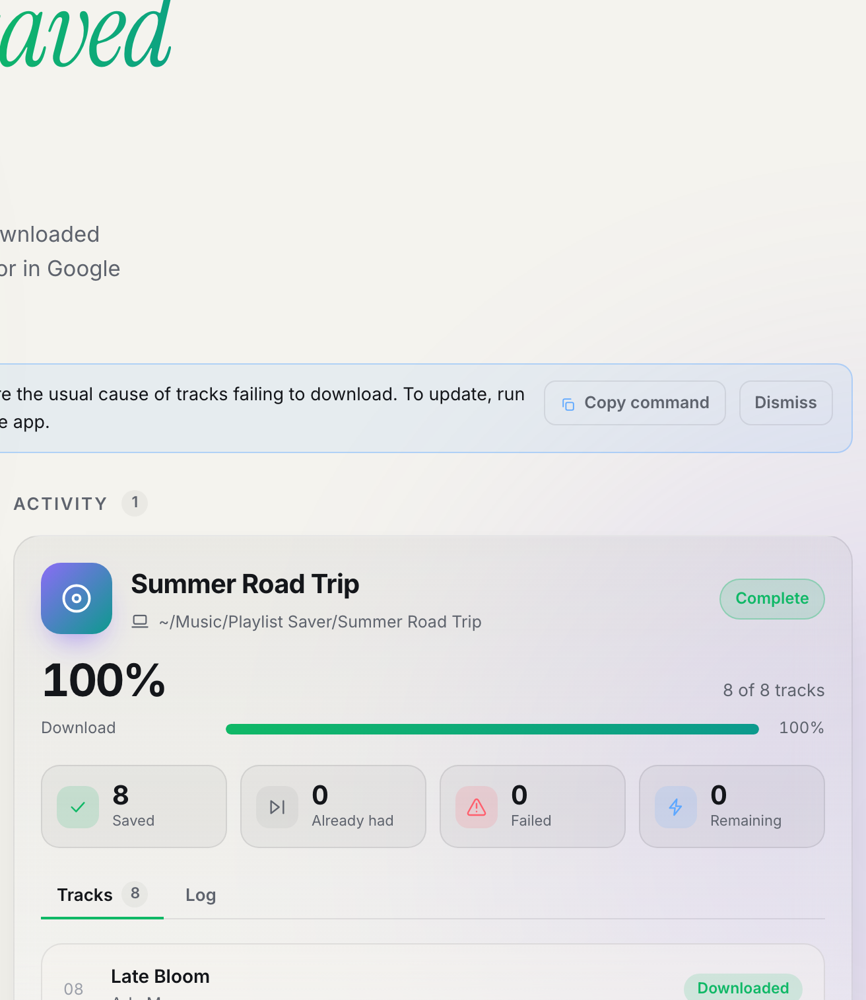

<sub>A finished download. Use the **Tracks** tab for each song and **Log** for technical details.</sub>

You can cancel a running download at any time. If several are waiting, a queued one can be cancelled before it starts.

> [!TIP]
> Closing the browser tab does not stop a download. The work happens on your computer, so reopen the page to see where it got to.

### Choose where to save

Under **Save to** pick one of three tiles: **This Mac**, **Dropbox** or **Google Drive**. The cloud tiles only work after you connect them (see “Cloud storage”).

- **Folder on this Mac**: the main music folder. Click it to browse or create a folder. The default is `~/Music/spotify-dl`.
- **Put each playlist in its own folder**: on by default, so every playlist gets a folder named after it. Single songs always go straight into the main folder.
- **Make default**: remembers your choice for next time. You can also change defaults later in Settings → Defaults.

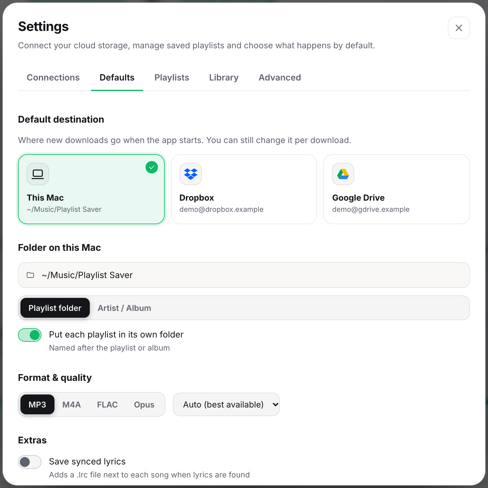

<sub>Settings → Defaults holds everything you want remembered.</sub>

> [!IMPORTANT]
> If you downloaded a playlist before turning on playlist folders, it will download again into its new folder. Move the old files into that folder first to avoid it.

### Format and quality

- **MP3**: plays everywhere. The safe choice.
- **M4A**: Apple’s format; slightly better quality than MP3 at the same size.
- **FLAC**: a lossless container. Files are much bigger, but because the source is YouTube Music, they do not sound better.
- **Opus**: very efficient and good for phones and cars that support it.

**Auto (best available)** is the right quality setting for nearly everyone. Higher numbers such as 320 kbps only re-encode the same source into a bigger file.

> [!TIP]
> Not sure? Choose MP3 with Auto. It works on every device.

### Lyrics, playlist files and layout

- **Organise files → Playlist folder** saves `Playlist/Artist - Title`. **Artist / Album** saves `Artist/Album/01 - Title`, like a music-library layout.
- **Save synced lyrics** adds a `.lrc` file next to each song when lyrics are found, so supported players show lyrics in time with the music.
- **Write a playlist file (.m3u8)** keeps the original track order for players such as VLC. It uses relative paths, so it keeps working if you move the folder.

If a playlist file already exists in a cloud folder it is left as it is (nothing is overwritten), so delete it there first if you want a fresh one.

> [!TIP]
> Turn any of these on permanently in Settings → Defaults.

---

## Cloud storage

### Saving to Dropbox or Google Drive

Pick **Dropbox** or **Google Drive** under **Save to**. There are three ways to use them:

- **Direct**: leave “Also keep a copy on this Mac” off. Files go through a temporary folder, are uploaded, then removed from your computer.
- **Copy**: turn “Also keep a copy on this Mac” on. You keep the files locally and in the cloud.
- **After the fact**: on a finished download, press “Copy to Dropbox / Google Drive” to send what you already have.

**Nothing is ever overwritten.** Before saving, the app looks at what is already in the cloud folder and skips songs with the same name. Re-running a link only fetches what is missing. If an upload fails, the file is kept on your computer so you can retry.

You must connect each service once. The next two sections show how.

### Connect Dropbox

Dropbox needs you to register a small personal “app” (this is free and takes about 2 minutes). It is what lets Playlist Saver use only your own account.

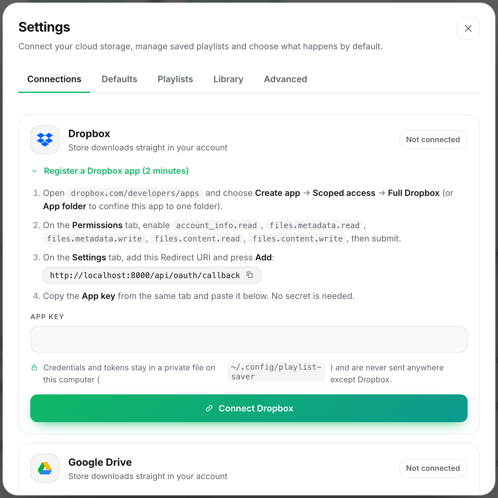

<sub>Open **Settings → Connections** and expand “Register a Dropbox app”. The steps are listed right there.</sub>

1. Open dropbox.com/developers/apps and click **Create app**.
2. Choose **Scoped access**, then **App folder** (safest, confines the app to one folder) or **Full Dropbox**. Give it any name.
3. On the **Permissions** tab tick `account_info.read`, `files.metadata.read`, `files.metadata.write`, `files.content.read` and `files.content.write`, then click **Submit**.
4. On the **Settings** tab, find **Redirect URIs**, paste the address shown in the app (`http://localhost:8000/api/oauth/callback`) and press **Add**. The app has a copy button for it.
5. Copy the **App key** from the same tab, paste it into the **App key** box in Playlist Saver, and press **Connect Dropbox**. No secret is needed.
6. Dropbox asks you to allow access. Click **Allow**. The page then shows “Connected”.

> [!TIP]
> If you changed the server port, the redirect address uses your port instead of 8000. See “Change the server port”.

### Connect Google Drive

Google also needs a personal “OAuth client” (free, about 5 minutes). It looks long but you only do it once.

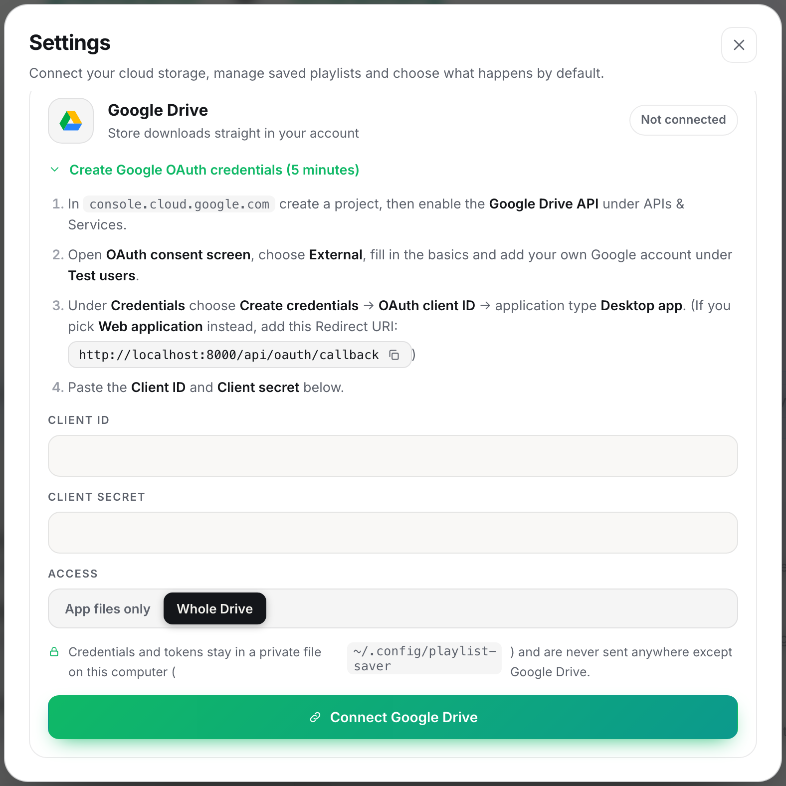

<sub>The same steps are shown in **Settings → Connections** under “Create Google OAuth credentials”.</sub>

1. Open console.cloud.google.com, create a project, then enable the **Google Drive API** under “APIs & Services”.
2. Open **OAuth consent screen**, choose **External**, fill in the basics and add your own Google address under **Test users**.
3. Under **Credentials** choose **Create credentials → OAuth client ID** and the type **Desktop app**. If you choose “Web application”, add the redirect address shown in the app.
4. Paste the **Client ID** and **Client secret** into Playlist Saver.
5. Choose the access level (below) and press **Connect Google Drive**, then allow access in the Google window.

- **App files only**: the app can see only files and folders it created. This is the safest choice.
- **Whole Drive**: lets you choose any existing folder and spot songs already there.

Your credentials stay in a private file on your computer (`~/.config/playlist-saver/config.json`) and are never sent anywhere except to Google.

### Reconnect or disconnect

Connections are remembered, and the app refreshes them automatically. At start-up it checks each one. If you revoked access from Dropbox or Google, the app shows **Reconnect** instead of failing quietly. A network outage never signs you out.

To remove a connection and its stored tokens, open **Settings → Connections** and press **Disconnect**. The app asks you to confirm. Your files in the cloud are not touched.

---

## Automatic updates

### Keep a playlist in sync

Under **Keep in sync** choose **Daily** or **Weekly** before pressing Download. The app then re-checks the playlist on schedule and adds only songs it does not already have.

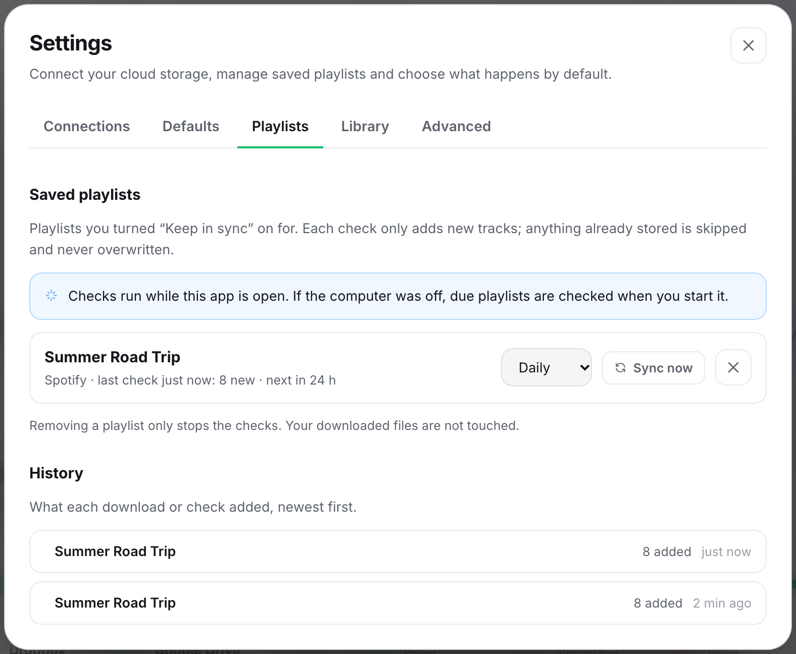

<sub>Settings → Playlists lists everything you keep in sync, and below it the History.</sub>

- Change the schedule with the drop-down, or press **Sync now** to check right away.
- Press the **✕** to stop syncing. This never touches your files.
- The line under each name shows the last check, how many songs were new and when the next one is due.

> [!IMPORTANT]
> Checks only run **while the app is running**. If your computer was off, due playlists are checked the next time you start the app. If a check fails (for example, no internet), it is tried again about an hour later.

> [!TIP]
> The Keep in sync choice only appears for playlists and albums, not single songs.

### History and the download queue

**History** (in Settings → Playlists, under your saved playlists) lists every download and check, how many songs it added and when.

Only a few downloads run at the same time (two by default). The rest wait in a queue and start by themselves. This stops Spotify and YouTube from slowing you down when several playlists are due together.

1. Open **Settings → Defaults**.
2. Change **Downloads at once** to a number from 1 to 4.

> [!TIP]
> If you often see slow lookups or failures, lower it to 1.

---

## Keeping things tidy

### Find duplicate songs

The same song often appears in several playlists, so it can end up stored more than once. The duplicate finder shows where.

1. Open **Settings → Library**.
2. Press **Scan my library**.
3. Review the list. Each song shows its copies, the folder of each and the size.

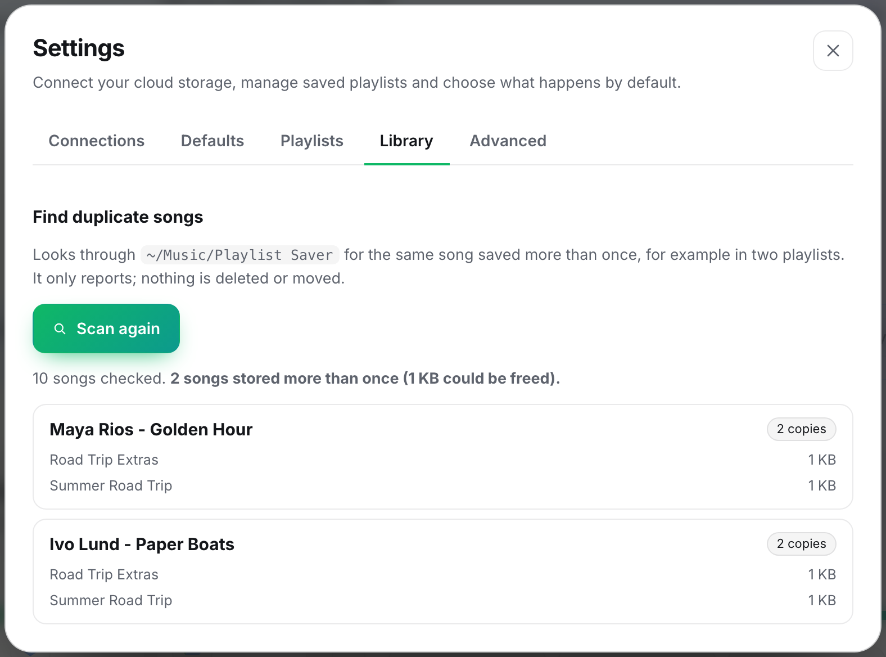

<sub>Each group lists the folders that hold a copy.</sub>

> [!IMPORTANT]
> The scan only **reports**. Nothing is ever deleted or moved. Remove copies yourself in Finder if you want the space back.

### Update spotDL and yt-dlp

YouTube changes often, so an old spotDL or yt-dlp is the most common reason songs fail. The app checks for newer versions (an anonymous request that sends none of your data) and shows a banner when one exists.

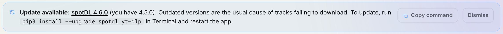

<sub>The banner names the new version and gives the command to run.</sub>

1. Press **Copy command** on the banner.
2. Open Terminal, go to the app’s folder (see “Step 3” of the install guide), paste it and press Return.
3. Restart Playlist Saver.

**Example (the Copy command button gives the exact line for your setup)**

```bash
.venv/bin/pip install --upgrade spotdl yt-dlp
```

Press **Dismiss** to hide the banner for that version. It comes back when an even newer one is released.

### Change the server port

The helper behind the screen uses **port 8000** by default. Only change this if another program already uses it.

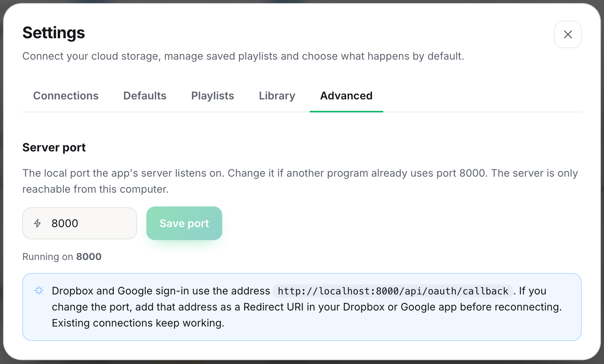

<sub>Settings → Advanced is where the port is set.</sub>

1. Open **Settings → Advanced**.
2. Enter a number between 1024 and 65535 and save. The app checks that it is free.
3. Press **Restart now** to bring the helper back on the new port. It waits for running downloads to finish.

> [!IMPORTANT]
> Dropbox and Google sign-in addresses contain the port. After changing it, add the new address (`http://localhost:<port>/api/oauth/callback`) as a Redirect URI in your Dropbox or Google app before reconnecting. Existing connections keep working.

---

## Help

### Troubleshooting

- **“spotDL missing” banner**: the helper can’t find spotDL. Run `.venv/bin/pip install -r server/requirements.txt` from the app’s folder (Step 4 of the install guide).
- **“API offline” banner won’t clear**: use the **Start server** button in the banner. If it keeps failing, run `../.venv/bin/python -m uvicorn main:app --port 8000` inside the `server` folder and read the error. Usually a package is missing (repeat Step 4 of the install guide), or another program uses the port.
- **“address already in use”**: another program has the port. Stop it, or choose another port (“Change the server port”).
- **Some songs fail with AudioProviderError**: run `.venv/bin/spotdl --download-deno` from the app’s folder, then download the same link again. Saved songs are skipped.
- **“ffmpeg was not found”**: run `brew install ffmpeg`.
- **Lookup is slow or stalls**: Spotify limits how fast it answers. Wait a minute, and avoid running many downloads at once.
- **A private playlist won’t load**: spotDL can only read public playlists unless you use your own Spotify developer keys. Make the playlist public.
- **The wrong song was saved**: matches come from a YouTube search, so a live or cover version can slip in. Delete the file and download the single track by its own link.
- **The shortcut does nothing**: read `~/.config/playlist-saver/launcher.log`.

> [!TIP]
> The **Log** tab on a download card shows exactly what happened, which helps when asking for support.

### Questions and privacy

- **Is it free?** Yes. The app and the tools it uses are open source.
- **Where does my data go?** Nowhere. Settings and tokens are in `~/.config/playlist-saver` on your computer. The app only contacts Spotify, YouTube, your cloud service and PyPI (for the update check).
- **Can websites control it?** No. The helper accepts requests only from your own computer.
- **Does it work offline?** You need the internet to find and fetch songs. Saved music plays offline, of course.
- **How do I uninstall it?** Remove the Desktop icon with `scripts/install-shortcut.sh --remove`, then delete the app’s folder. Your music is not affected.

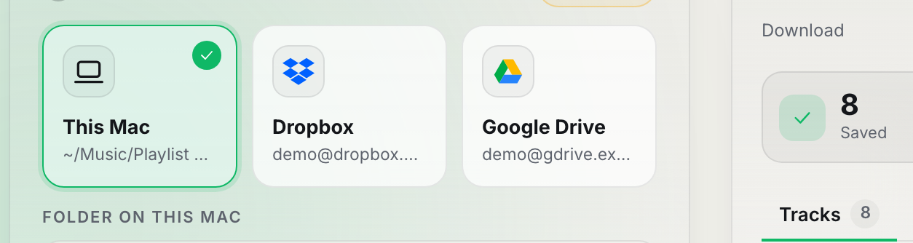

> [!IMPORTANT]
> Playlist Saver is only a graphical interface. It does not host, store or download any content itself. It runs spotDL, yt-dlp and FFmpeg on your own computer. Use it only for music you have the right to copy.
